# Giro da utente vero in produzione — 1/11/2026

Collaudatore e designer separato (non ha scritto il codice). Sito: https://mapetite-web.vercel.app, telefono simulato 390×844, italiano, posizione Roma centro (41.889, 12.47), account di prova `claude-e2e@example.com` (5 salvati a Roma).
Ricerche Google vere usate: **1** ("cena romantica a Trastevere"). Nessun dato dell'account modificato.
Screenshot: `screenshots/2026-11-01-giro/`.

Riferimenti usati per il confronto: `docs/autonomia/riferimenti/` (Places 02, 04, 05; Albo 08, 12).

## Perché Lorenzo "non vede miglioramenti"
Le cose rifatte di recente (carosello scuro dei risultati, verdetto in corsivo nella scheda, home con titolo serif) ci sono e sono buone. Ma chi apre l'app vede prima altro: **quasi nessuna foto** (emoji su sfondi colorati in home, salvati, scheda, raccolte, mappa dei salvati), **la mappa vuota** all'apertura, **un avviso fisso** che copre il fondo di ogni schermata, e **tre stili di titolo diversi** tra una schermata e l'altra. Places ha una foto vera in ogni card e una mappa piena di segnalini con foto e nome. Finché mancano foto e segnalini l'app sembra un prototipo, anche se sotto c'è molto lavoro.

## Le 10 correzioni con più effetto visibile
1. **Foto vere ovunque ci sia un locale** (scheda, lista e mappa dei salvati, card "Per te", classifica). Oggi la scheda di Hostaria Del Moro ha un piatto di spaghetti emoji al posto della foto, e per vederne una rimanda a Google Maps. Le foto si caricano già nei risultati di ricerca: stesso componente, senza salvarle sui nostri server (termini Google), dentro la quota di 200 al giorno.
2. **Mappa piena all'apertura**: oggi `/mappa` è grigia, con il solo pallino blu, anche se Hostaria Del Moro (salvato) è a 250 m. Mostrare subito i salvati come segnalini con emoji/foto e nome (come Albo 08 e Places 04).
3. **Togliere l'avviso fisso "A 250 m c'è Hostaria Del Moro…"**: compare su mappa, risultati e salvati e copre il fondo della card e della lista. Va mostrato una volta, chiudibile, e mai sopra i risultati di una ricerca.
4. **Inquadratura dopo la ricerca**: la mappa si allarga fino a Kiko Sushi Bar (salvato a 4 km, fuori tema) e i 12 risultati di Trastevere finiscono ammassati e tagliati sul bordo sinistro. Inquadrare solo i risultati; i salvati fuori zona non spostano la mappa.
5. **Scheda a tutto schermo e pulita**: la pillola "1 di 5" si sovrappone ai tasti chiudi/condividi e alla lista dietro, che si vede in grigio sopra la scheda. Scheda intera come Places 05, con lo scorrimento tra i posti dentro la barra in basso.
6. **Dati essenziali nella scheda**: mancano voto, prezzo, "aperto ora", orari, telefono. C'è solo "250 m" e un link "Orari e foto su Google Maps →", che porta fuori dall'app (contro la promessa "senza saltare tra app").
7. **Un solo stile di titolo**: home, salvati e scheda usano un serif da rivista; "Stasera dove andiamo?", importa, profilo, raccolte e assistente usano Poppins grassetto. Sembrano due app. Serif per titoli e nomi dei locali dappertutto, Inter per il resto.
8. **Risultati stabili mentre arrivano**: a 8 secondi il primo è "CASA ENCANTO ROMA" (una churrascaria con "cocktail ottimi", per una cena romantica), a 20 secondi il primo diventa "Oste nostro". L'ordine salta sotto il dito; i segnalini restano cerchi bianchi vuoti per secondi. Ordine fermo dal primo momento, segnalino con emoji finché non arriva la foto.
9. **Raccolte da rifare**: in Profilo il riquadro "Raccolte" dice 1, ma la sezione mostra "5 salvati senza raccolta" e nessuna raccolta. Nei Salvati il cerchio "Stasera" sembra una raccolta ma è uno strumento. Le raccolte vanno in cima ai Salvati, come copertine con foto (Albo 12, Places 07).
10. **Profilo corto**: oggi sono 5 schermate di scorrimento con più di 20 voci, 3 inviti all'azione prima dei propri numeri e un "Ci sei stato?" in mezzo. Lasciare foto, nome, i 3 numeri e "Le mie cose"; tutto il resto in Impostazioni.

## Voti per schermata (contro Places e Mapstr)

| Schermata | Voto |
|---|---|
| Accesso | 7 |
| Intro al primo avvio | 7 |
| Home | 6,5 |
| Mappa all'apertura | 4 |
| Pannello "Idee / Ti suggeriamo" | 5,5 |
| Ricerca: attesa | 5 |
| Ricerca: risultati (carosello + mappa) | 6 |
| Scheda locale (da salvati) | 5 |
| Salvati: lista | 6 |
| Salvati: mappa | 5 |
| "Stasera dove andiamo?" | 6 |
| Raccolte | 3,5 |
| Importa | 6,5 |
| Profilo | 4,5 |
| Assistente | 5,5 |
| Primo accesso (mappa del gusto) | 7 |

Media: circa **5,6**. Nessuna schermata arriva all'8,5 richiesto per la produzione.

---

## Accesso — 7
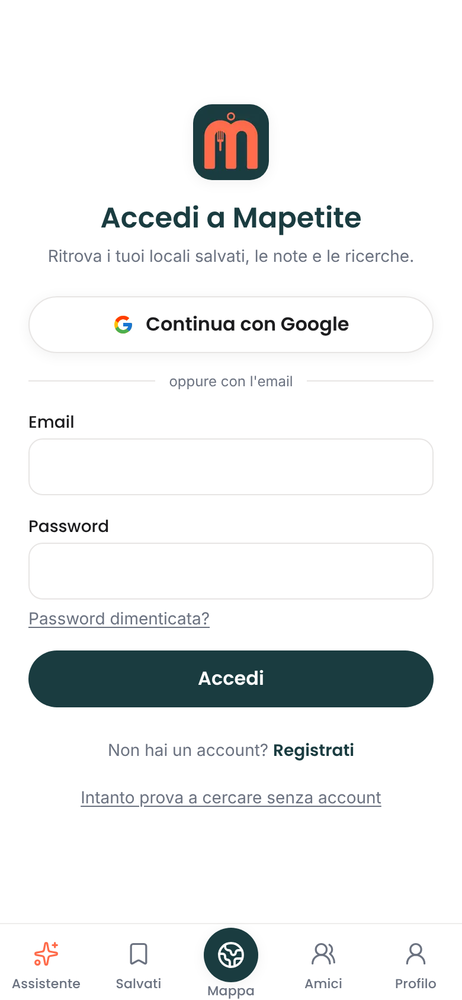 `00-login.png`
- D1 (bassa) La barra in basso (Assistente, Salvati, Mappa…) compare anche nella pagina di accesso: porta a pagine che chiedono di nuovo l'accesso. → Nascondere la barra in `/login`.
- D2 (bassa) Dopo l'accesso un utente con 5 salvati finisce su `/onboarding`, invece che sulla home. → Mandare all'onboarding solo chi non ha salvati né gusti.

## Intro al primo avvio — 7
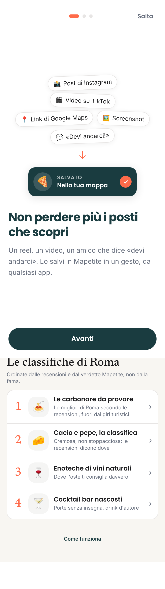 `00b-intro-primo-avvio.png`
- D3 (media) Compare a un utente che usa già l'app (5 salvati) appena cambia telefono o browser, perché si ricorda solo nel browser. → Non mostrarla a chi ha già salvati.
- Bene: chiara, una frase, un pulsante, come Albo 01–05.

## Home — 6,5
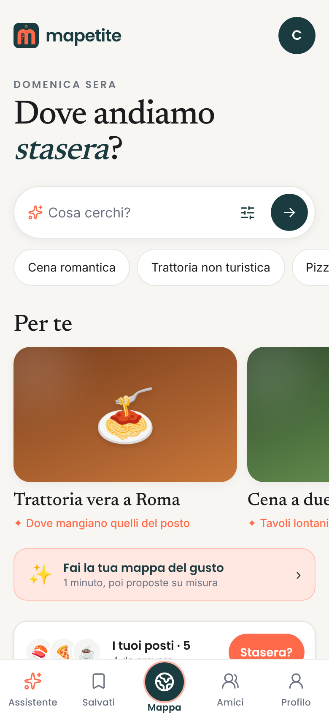 `01-home.png`, intera `01b-home-intera.png`, campo toccato `04a-campo-ricerca-focus.png`
- D4 (alta) Le card "Per te" ("Trattoria vera a Roma", "Cena a due") sono un'emoji su un gradiente marrone/verde: sembrano segnaposto. Places mostra foto vere a tutta card. → Foto di un locale vero per ogni card, o card più piccole senza riquadro immagine.
- D5 (media) Nella barra in basso è acceso "Mappa" anche se sei sulla home. → Nessuna voce accesa, o una voce "Home".
- D6 (media) Troppi blocchi: titolo, campo, 3 chip, "Per te", banner "Fai la tua mappa del gusto", "I tuoi posti · 5" con "Stasera?", "Le classifiche di Roma", "Come funziona". Places in home ha solo il campo e 2–3 suggerimenti. → Tenere campo, chip e "Per te"; il resto in Salvati/Mappa.
- D7 (bassa) Il riquadro "I tuoi posti · 5 / 4 da provare" è tagliato dalla barra in basso nella prima schermata. → Spostarlo sopra "Per te" o toglierlo (doppione di Salvati).
- D8 (bassa) Toccare il campo non apre niente (nessun suggerimento, nessuna ricerca recente). → Mostrare le ultime ricerche (Places 12).
- Bene: titolo "Dove andiamo *stasera*?" con l'ora del giorno, classifiche "non dalla fama": è il tono giusto.

## Mappa all'apertura — 4
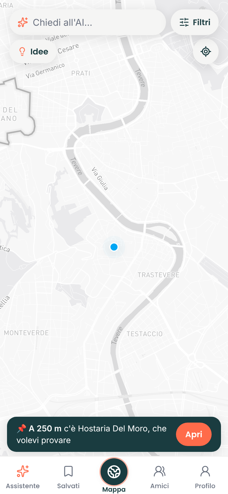 `02-mappa.png`, `02-mappa-dopo-6s.png`
- D9 (alta) Mappa vuota: zero segnalini anche dopo 6 secondi, con un salvato a 250 m. È la prima cosa che si vede toccando il tasto centrale. → Segnalini dei salvati e, se pochi, dei locali consigliati in zona.
- D10 (alta) L'avviso "📌 A 250 m c'è Hostaria Del Moro, che volevi provare / Apri" è fisso in basso; lo stesso locale non è segnato sulla mappa. → Segnare il locale sulla mappa e rendere l'avviso chiudibile e una tantum.
- D11 (media) Il campo si chiama "Chiedi all'AI…" qui, "Cosa cerchi?" in home e "Scrivi o detta cosa cerchi…" nell'assistente: tre ingressi per la stessa cosa. → Stessa frase, stesso comportamento.

## Pannello "Idee / Ti suggeriamo" — 5,5
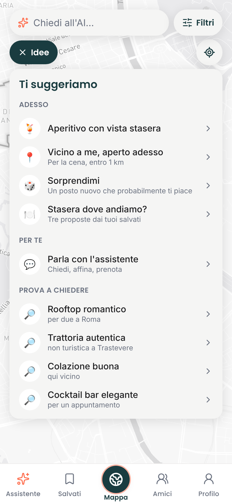 `03-idee.png`, `03b-barra-vuota-toccata.png`
- D12 (media) Nove righe uguali in tre sezioni: copre tutta la mappa e sembra un menu di impostazioni. → 4 proposte al massimo, come chip orizzontali sopra la mappa (Places 04: "Table Tonight", "Newly opened").
- D13 (media) "Parla con l'assistente" e "Stasera dove andiamo?" sono doppioni di Assistente e del cerchio "Stasera" nei Salvati. → Toglierli dal pannello.
- D14 (bassa) Quattro lenti 🔎 identiche nella sezione "Prova a chiedere". → Emoji per tipo (🍸, ☕, 🍝).

## Ricerca: attesa — 5
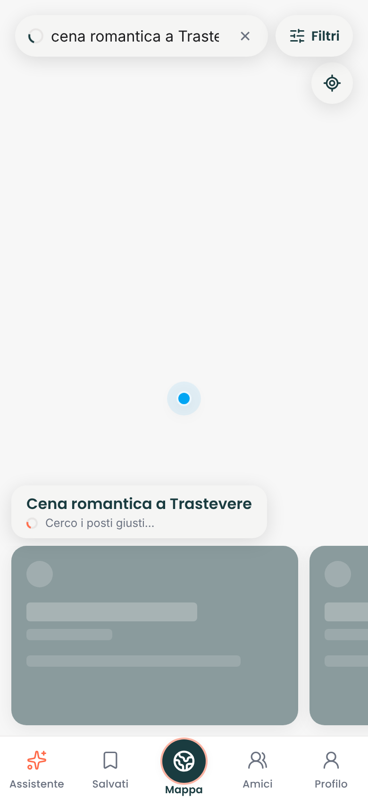 `04b-ricerca-1500ms.png`, `04b-ricerca-4000ms.png`, `04b-ricerca-8000ms.png`
Tempi misurati: elenco a 3,4 s, verdetti tra 6,9 e 9 s, ordine definitivo dopo circa 20 s.
- D15 (alta) Per 1–2 secondi la mappa è tutta bianca (solo il pallino blu) sotto le card grigie di caricamento. → Tenere la mappa di partenza visibile mentre si cerca.
- D16 (alta) Segnalini come cerchi bianchi vuoti finché le foto non arrivano. → Emoji del tipo di locale come base.
- D17 (alta) L'ordine cambia mentre guardi: prima "CASA ENCANTO ROMA" (badge 💎 "Poco conosciuto", verdetto "Cocktail ottimi…"), poi primo "Oste nostro". → Ordine fermo; i verdetti riempiono le card senza riordinarle.
- D18 (media) L'avviso "A 250 m c'è…" copre metà della prima card durante la ricerca. → Mai sopra i risultati.
- D19 (bassa) Il testo cercato è tagliato: "cena romantica a Traste". → Una riga che scorre o due righe.

## Ricerca: risultati — 6
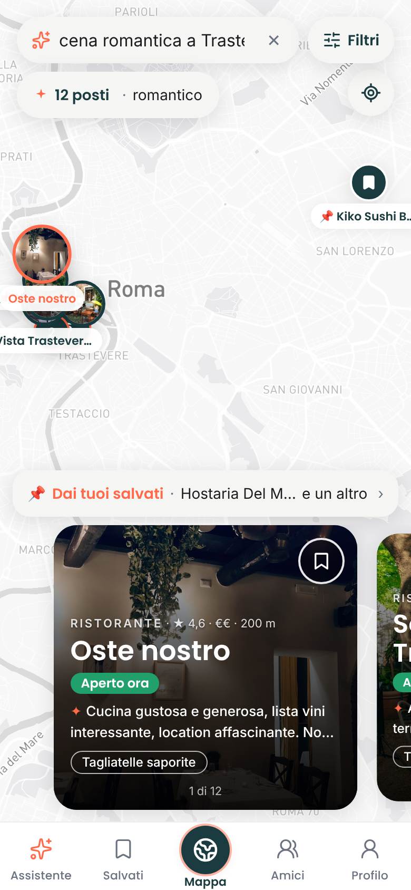 `05-risultati.png`
- D20 (alta) La mappa inquadra tutta Roma per includere Kiko Sushi Bar (salvato, a 4 km, fuori tema): i risultati sono un grumo tagliato sul bordo sinistro, con etichette sovrapposte ("Oste nostro" sopra "…ista Trastever…"). → Inquadrare solo i risultati.
- D21 (media) Il primo verdetto ("Cucina gustosa e generosa… Non è turistico nonostante il quartiere") non parla di romanticismo, che è la richiesta. Places apre con una frase che risponde alla domanda. → Il verdetto della card dice perché va bene *per questa richiesta* (matchReason), poi il resto.
- D22 (media) Manca un'apertura editoriale: Places scrive una frase e un titolo ("Rome essentials") prima dei posti. → Una riga di sintesi sopra il carosello.
- D23 (media) Tutti e 12 i risultati hanno la stessa emoji 🍝, anche il sushi e i cocktail bar. → Emoji per tipo vero (`src/lib/emoji.ts`), verificando prima i salvati esistenti.
- D24 (media) Nomi tutti maiuscoli come arrivano da Google ("CASA ENCANTO ROMA") stonano accanto agli altri. → Normalizzare le maiuscole in visualizzazione.
- D25 (media) Se ricarichi o torni indietro la ricerca sparisce: l'indirizzo resta `/mappa`. Non si può condividere né ritrovare. → La richiesta nell'indirizzo (`/mappa?q=…`) e nella cronologia.
- D26 (bassa) "Dai tuoi salvati · Hostaria Del M… e un altro" è tagliato. → "2 dei tuoi salvati" più le faccine.
- Bene: card scura a foto piena, "Aperto ora", chip del piatto forte. È la schermata più vicina a Places 04.
- Non verificato: la lista a tutto schermo dei risultati (pillola "12 posti") e la scheda di un risultato. La ricerca non resta nell'indirizzo e c'era una sola ricerca vera disponibile.

## Scheda locale (da Salvati) — 5
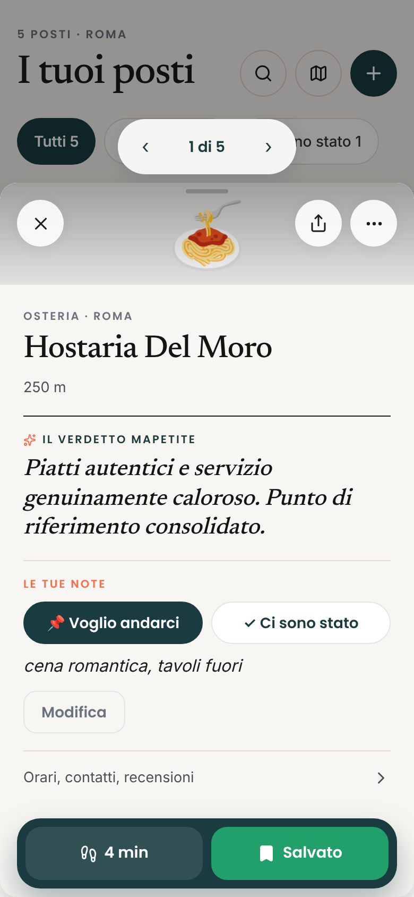 `08-scheda.png`, `08-scheda-1s.png`, `08c-scheda-orari-contatti.png`, `08d-scheda-orari-contatti-giu.png`
- D27 (alta) Nessuna foto: un piatto emoji in cima. Places 05 apre con un carosello a tutta larghezza. → Carosello foto.
- D28 (alta) La pillola "1 di 5" galleggia sopra la scheda e, scorrendo, copre i tasti chiudi/condividi/altro. Dietro si vede la lista "I tuoi posti" in grigio, con i pulsanti tagliati dal bordo. → Scheda a tutto schermo; frecce tra i posti nella barra in basso o con lo scorrimento laterale.
- D29 (alta) Mancano voto, numero di recensioni, prezzo, aperto/chiuso, orari, telefono. In "Info" c'è solo l'indirizzo e "Orari e foto su Google Maps →". → Riga "★ 4,4 · €€ · Aperto fino alle 23" sotto il nome; orari e telefono in Info.
- D30 (media) Tipo incoerente: la scheda dice "OSTERIA", la lista "Ristorante italiano". → Un'unica fonte per il tipo.
- D31 (media) Il pulsante "Salvato" è verde, colore che non è del marchio (teal + corallo). → Teal pieno con l'icona segnalibro.
- D32 (media) "Voglio andarci" in teal pieno sembra il pulsante principale, ma è uno stato. → Interruttore a due stati più leggero (come Places 07).
- D33 (bassa) "Orari, contatti, recensioni" è una riga grigia chiusa: le cose utili sono nascoste. → Aperta di default.
- Bene: il verdetto in serif corsivo è l'elemento più "Mapetite" dell'app; la nota privata "cena romantica, tavoli fuori" si vede subito.

## Salvati: lista — 6
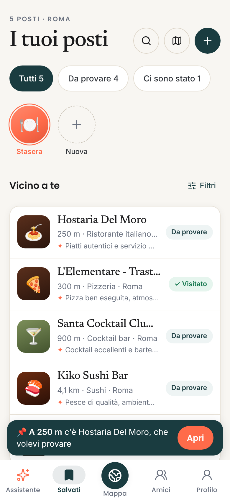 `06-salvati-lista.png`, `06b-salvati-lista-intera.png`
- D34 (alta) Riquadri con emoji al posto delle foto: 5 locali, 5 quadrati marroni/verdi. → Miniatura foto (Places, Mapstr).
- D35 (media) Nomi tagliati: "L'Elementare - Trast…", "Santa Cocktail Clu…"; i verdetti finiscono a metà parola ("atmos…"). → Etichetta di stato sotto il nome invece che a destra, così il nome ha tutta la riga.
- D36 (media) Etichette diverse per la stessa cosa: filtro "Ci sono stato 1", etichetta "✓ Visitato". → "Ci sono stato" ovunque.
- D37 (media) L'avviso "A 250 m c'è…" copre il quinto salvato. → Vedi correzione 3.
- D38 (bassa) Due "Filtri" (in cima, nascosto, e accanto a "Vicino a te") più la lente e i filtri a pillola. → Un solo punto per filtrare.
- D39 (bassa) Il cerchio "Stasera" sembra una raccolta (stile "storie") ma apre uno strumento. → Pulsante "Stasera?" distinto dalle raccolte.

## Salvati: mappa — 5
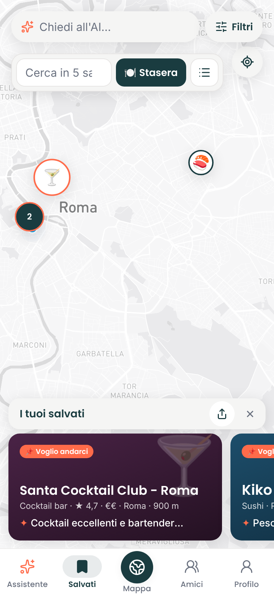 `07-salvati-mappa.png`
- D40 (alta) Due campi di ricerca uno sotto l'altro ("Chiedi all'AI…" e "Cerca in 5 sa…", tagliato). → Uno solo: nei Salvati cerca nei salvati.
- D41 (media) Bar Necci (5 km) non si vede: l'inquadratura non comprende tutti i salvati. Il gruppo "2" copre il pallino blu della posizione. → Inquadrare tutti i salvati; posizione sopra i segnalini.
- D42 (media) Card senza foto e con colori a caso (viola per il cocktail bar, blu per il sushi). → Foto o un solo colore del marchio.
- D43 (bassa) Segnalini solo emoji senza nome: Albo e Places mettono il nome sotto. → Nome sotto il segnalino a zoom di quartiere.

## "Stasera dove andiamo?" — 6
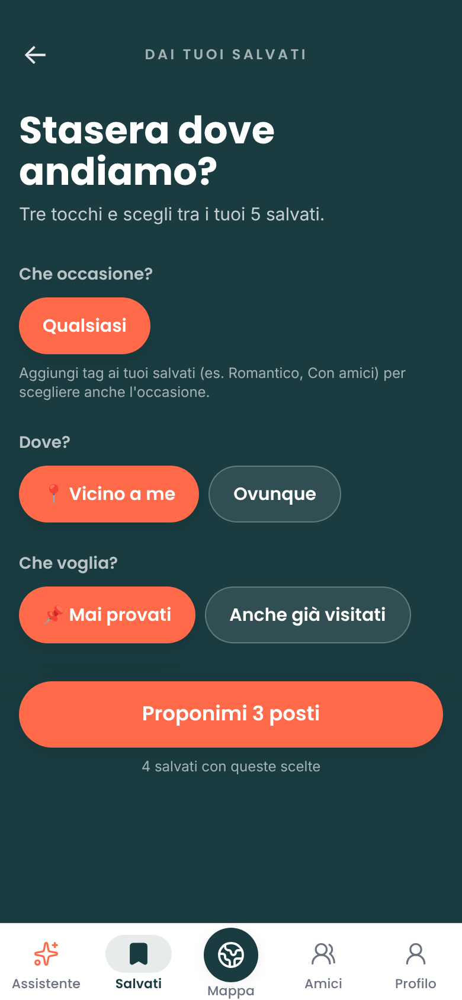 `09-stasera-dai-salvati.png`
- D44 (media) Tutto teal scuro con Poppins grassetto: sembra un'altra app rispetto ai Salvati beige con il serif. → Stesso fondo e caratteri del resto.
- D45 (media) Le scelte attive e il pulsante finale hanno lo stesso corallo: non si capisce cosa è selezionato e cosa si preme. → Attive in bianco su teal, solo il pulsante in corallo.
- D46 (bassa) "Che occasione?" ha una sola scelta ("Qualsiasi") più una spiegazione. → Nascondere la domanda finché non ci sono tag.

## Raccolte — 3,5
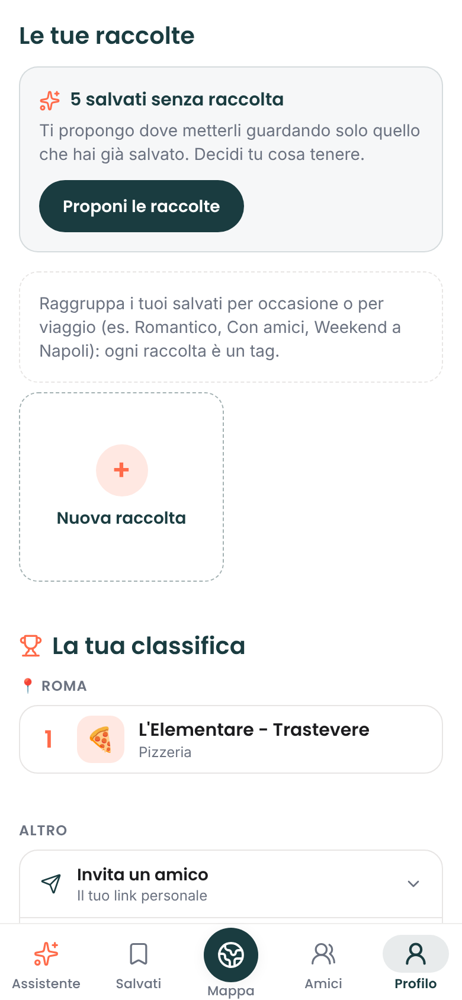 `14-raccolte.png` (si arriva da Profilo → Raccolte, che porta a `/profilo#raccolte`)
- D47 (alta) Il riquadro dice "Raccolte 1", ma la sezione mostra "5 salvati senza raccolta" e nessuna raccolta: numero sbagliato o raccolta invisibile. → Verificare il conteggio; mostrare la raccolta.
- D48 (alta) Le raccolte non hanno una pagina: sono a metà del Profilo. In Places e Albo stanno con i salvati. → Riga di copertine in cima ai Salvati.
- D49 (media) Due riquadri di spiegazione (uno pieno, uno tratteggiato) più una card tratteggiata "Nuova raccolta" grande mezza pagina. → Stato vuoto unico, come Albo 12: una frase e un pulsante.

## Importa — 6,5
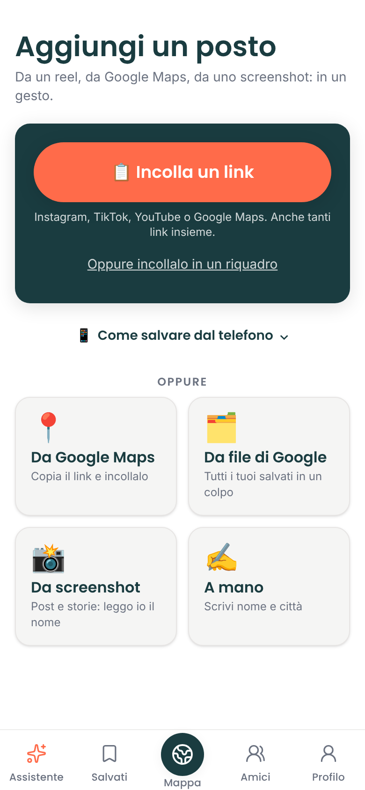 `10-importa.png`
- D50 (media) "Incolla un link" e "Da Google Maps · Copia il link e incollalo" fanno la stessa cosa. → Togliere il riquadro Google Maps.
- D51 (bassa) "Da file di Google" non dice cos'è (Google Takeout). → "Tutti i salvati di Google Maps".
- D52 (bassa) Fondo bianco, mentre home e salvati sono beige. → Stesso fondo.
- Bene: un'azione principale grande e chiara, come Albo 11.

## Profilo — 4,5
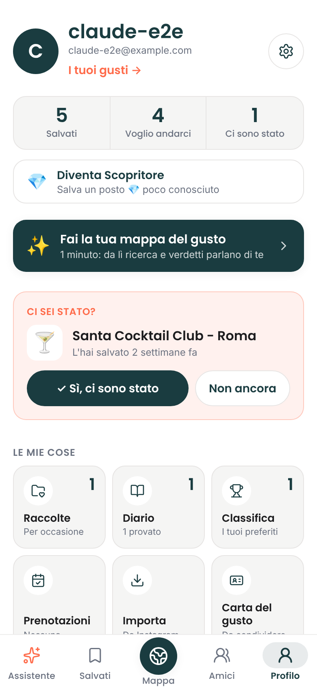 `11-profilo.png`, `11-profilo-intera.png`
- D53 (alta) Pagina lunghissima (circa 5 schermate): numeri, "Diventa Scopritore", banner mappa del gusto, "Ci sei stato?", 6 riquadri, raccolte, classifica, 6 voci "Altro", feedback, esci, elimina. → Tenere identità, numeri e "Le mie cose"; il resto in Impostazioni.
- D54 (media) Il banner "Fai la tua mappa del gusto" è sia in home sia qui, e "I tuoi gusti →" è un terzo ingresso. → Uno solo.
- D55 (media) Nella seconda riga di riquadri i sottotitoli sono tagliati dalla barra ("Nessuna", "Da Instagram…"). → Riquadri più bassi.
- D56 (bassa) Nome "claude-e2e" preso dall'email, senza foto: Places mostra nome e avatar. → Chiedere il nome all'onboarding.

## Assistente — 5,5
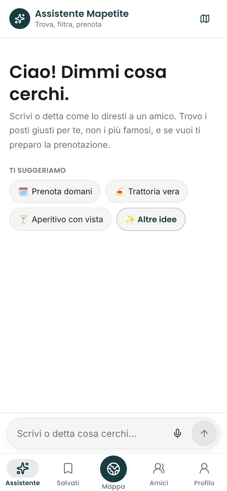 `12-assistente.png`
- D57 (media) Due terzi dello schermo vuoti; titolo in Poppins su fondo bianco, diverso dalla home. → Mostrare 2–3 risposte d'esempio con locali veri, oppure fondere con la home (stessa funzione).
- D58 (media) È un doppione del campo in home e in mappa: tre posti per chiedere la stessa cosa. → Decidere un solo ingresso; l'assistente come "continua la conversazione" dopo una ricerca (Places: "Ask a follow up").
- D59 (bassa) "Prenota domani" come primo suggerimento promette una funzione che è ancora in prova. → Togliere finché non c'è davvero.

## Primo accesso (mappa del gusto) — 7
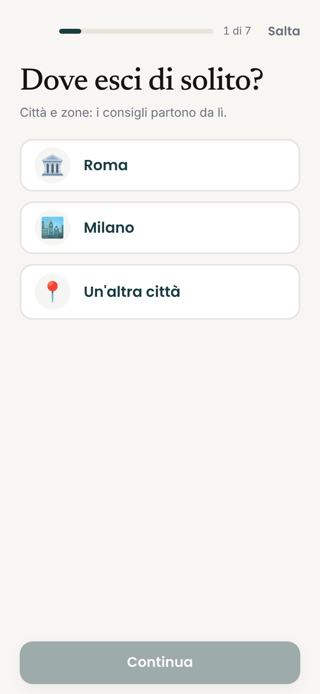 `13-onboarding.png`, `13b-onboarding-roma-scelta.png`, `13c-onboarding-passo2.png`
- D60 (media) La visione chiede "10 locali veri 👍/👎", ma le card sono *tipi* di posto con emoji su gradiente ("Trattoria di quartiere"). Con un tipo, "Non lo conosco" non ha senso. → Locali veri con foto della città scelta.
- D61 (bassa) 7 passi più 10 card: è lungo per "1 minuto". → Massimo 4 passi.
- Bene: una domanda per schermata, barra di avanzamento, card da trascinare. È la schermata più vicina ad Albo.

## Velocità (dal proxy dell'ambiente, indicativa)
Prima pittura: home circa 1,2 s, mappa 0,6 s, profilo 2,0 s. Ricerca: elenco a 3,4 s, verdetti a 9 s, ordine finale circa 20 s (D17). L'unica richiesta in errore visibile nei log è `/api/push/chiave` → 404 su Importa e Profilo (non si vede a schermo).

## Cosa fanno meglio i concorrenti, in sintesi
- **Places**: foto vera in ogni card, segnalino e scheda; una frase editoriale che risponde alla domanda; mappa sempre piena; scheda con voto, prezzo, "aperto ora" e barra azioni; un solo carattere da rivista ovunque.
- **Albo**: segnalini emoji con nome sotto; raccolte e libreria con stati vuoti curati; onboarding corto con risposte grandi.
- **Mapstr** (nessuno screenshot nel repo): salvati con foto e tag visibili sulla mappa, filtri per tag in un tocco.
- **Mapetite oggi è avanti** sul verdetto editoriale e sul "poco conosciuto". Ma quasi non si vede, perché tutto intorno sembra non finito.
