# Scegli il design — 21/10/2026

Lorenzo, 20/10: "graficamente non trovo benefici, l'app deve cambiare completamente entro il 25/10".
Qui ci sono 6 schermate, 3 varianti ciascuna. **Scegli una lettera per schermata** (oppure "tutto A") e da stanotte si costruisce quella.

## Come leggere
- Ogni schermata ha prima un'immagine di confronto (A · B · C affiancate), poi le tre immagini singole a 390×844.
- Le tre direzioni sono le stesse in tutte le schermate:
  - **A — Editoriale:** fondo carta caldo, titoli in serif (Newsreader), tanto spazio. Il verdetto si legge come una frase di rivista.
  - **B — Notte:** tutto scuro sul teal profondo, mappa notturna, vetro smerigliato, accenti corallo luminosi.
  - **C — Card bianche:** bianco pieno, Poppins, card grigio chiaro: la più vicina a Places.
- Marchio invariato in tutte: teal `#1a3c40`, corallo `#ff6b4a` (solo scintilla AI e una sola azione forte), Poppins + Inter.

## Cosa è vero e cosa no (leggere prima)
- **Tutti i nomi dei locali sono di esempio**, inventati: Terrazza Gianicolo, Altana Monti, Osteria del Cardo, Vineria Ombretta, Trattoria Sora Nella, Forno Trastevere 14, Bar Clivio, Pasticceria Ginestra, Orto Pigneto, Salotto 42, Belvedere Celio. Anche verdetti, distanze, numeri ("27 posti", "12 posti"), il nome "Giulia" e i profili del gusto sono testo di esempio.
- **Foto:** le foto dei rooftop sono ritagli del mockup scelto il 18/10 (`mapetite-lista-risultati-B-scelta.jpg`, immagine generata da AI, nostra). Le altre "foto" sono **segnaposto** (emoji su sfondo sfumato): nell'app ci saranno le foto Google del locale, mostrate come oggi (mai salvate sui nostri server). Dove l'app non ha foto, l'emoji resta come oggi.
- **Come sono fatti:** l'API immagini di OpenAI era bloccata dalla rete di questa sessione (il proxy ha rifiutato `api.openai.com` con 403), quindi la skill design-shotgun non poteva funzionare. I mockup sono stati disegnati a mano in HTML/CSS e fotografati con Chromium a 390×844. **Spesa OpenAI: 0 €.** Vantaggio: testi italiani esatti, colori e font veri del marchio, e i sorgenti in `docs/autonomia/mockup-21-10/` sono già una specifica precisa per chi costruisce (misure, colori, raggi).

---

## 1. Home (prima schermata dopo l'accesso)
Cosa principale: **"Cosa cerchi?"**. Poi, un tocco più in là: i suggerimenti per te e i tuoi posti.

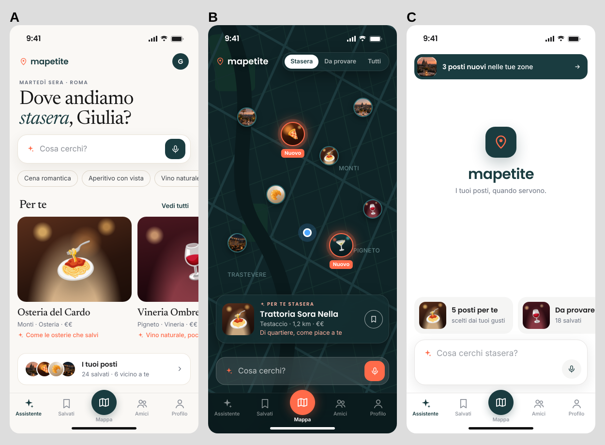

| | Direzione | Voto | Contro Places (`places-01`) |
|---|---|---|---|
| **A** | Saluto in serif "Dove andiamo stasera, Giulia?", campo grande, 3 pillole, "Per te" con 2 card foto e la riga corallo del perché, striscia "I tuoi posti". | **8,5** | Calma come Places ma in 10 secondi si capisce cosa fa Mapetite in più: il "perché per te" è già in home. |
| **B** | La mappa notturna è la home: pin dei tuoi salvati + pin "Nuovo" luminosi, una card "Per te stasera", campo cerca in vetro. | 7,5 | Più spettacolare di Places, ma doppia la schermata Mappa e su una foto Google chiara il vetro scuro perde contrasto. |
| **C** | Quasi Places: logo al centro, molto vuoto, 2 card piccole e campo in basso. | 7 | La più pulita, ma è un clone di Places: non mostra né i gusti né i salvati. |

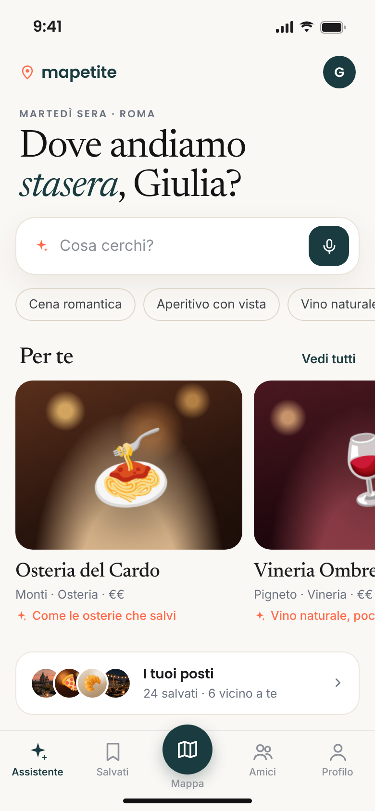 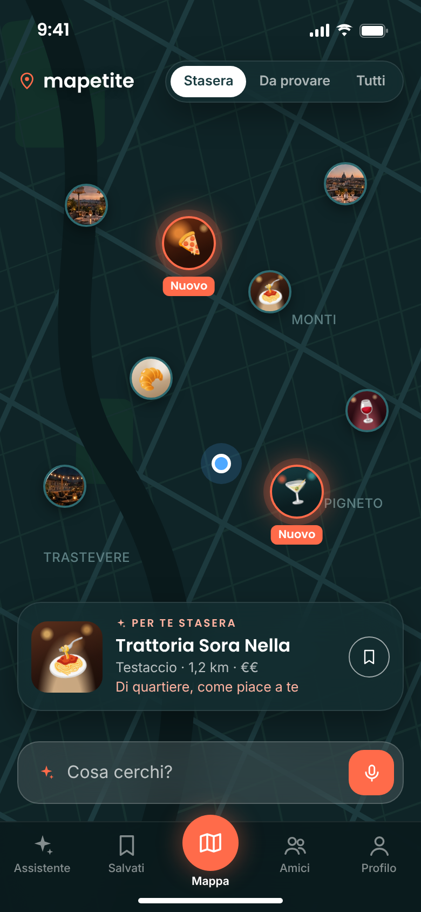 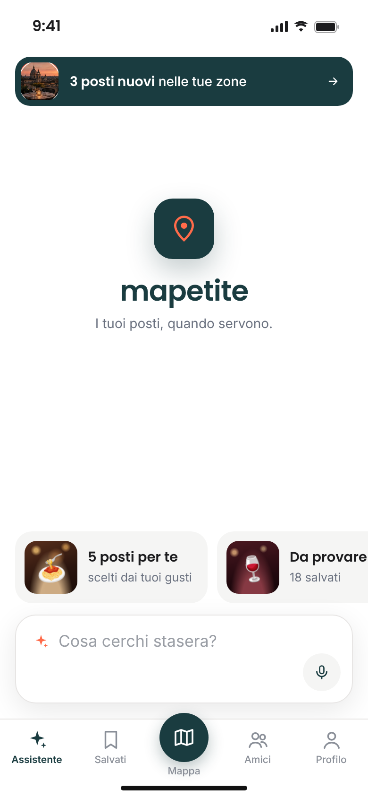

**Raccomandazione: A.** Una sola azione principale (cerca), e la prova del "ti conosco" visibile senza toccare niente.

---

## 2. Risultati di una ricerca (evoluzione della B scelta il 18/10)
Tutte e tre tengono la struttura scelta: mappa con pin-foto, carosello di card scure a foto piena, "1 di 12". Cambia come si vede l'AI.

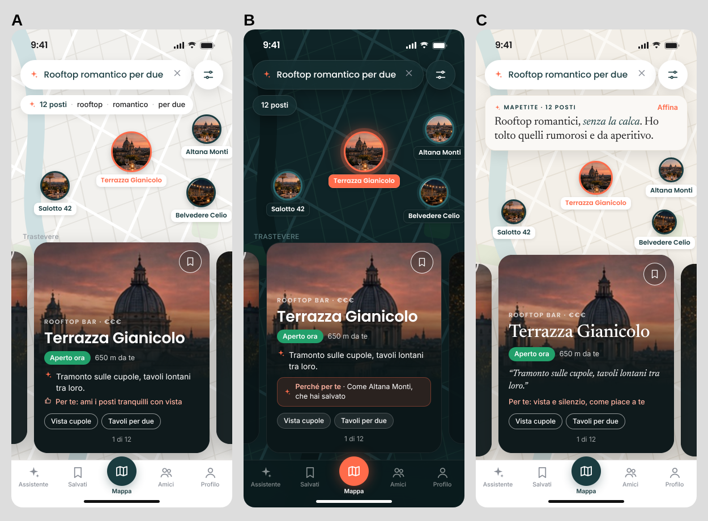

| | Direzione | Voto | Contro Places (`places-04`) |
|---|---|---|---|
| **A** | La B rifinita: sotto la ricerca la pillola "✨ 12 posti · rooftop · romantico · per due" (cosa ho capito); nella card verdetto + riga corallo "Per te: …". Niente puntini. | **8,5** | Stessa eleganza di Places, ma ogni card dice *perché* è lì e *perché a te*. Cambia poco rispetto alla scelta del 18/10: si costruisce in fretta. |
| **B** | Tutto in notturno: mappa scura, pin con alone corallo, riquadro "Perché per te · Come Altana Monti, che hai salvato". | 7,5 | Effetto "sera fuori" forte; nella demo di giorno su telefono si legge peggio, e mappa notturna = altro stile mappa da mantenere. |
| **C** | Sopra la mappa una risposta scritta in serif: "Rooftop romantici, senza la calca. Ho tolto quelli rumorosi e da aperitivo." + "Affina". Nomi in serif. | 8 | È il `places-02` (risposta AI editoriale) unito alla mappa: l'AI "si vede" di più, ma toglie spazio alla mappa. |

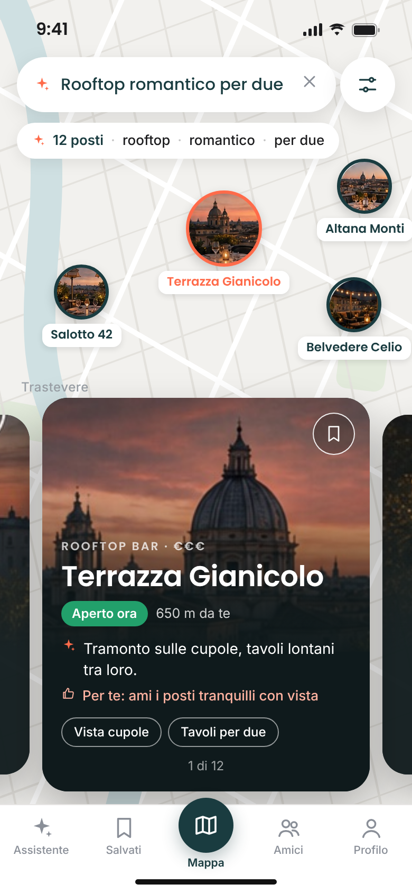 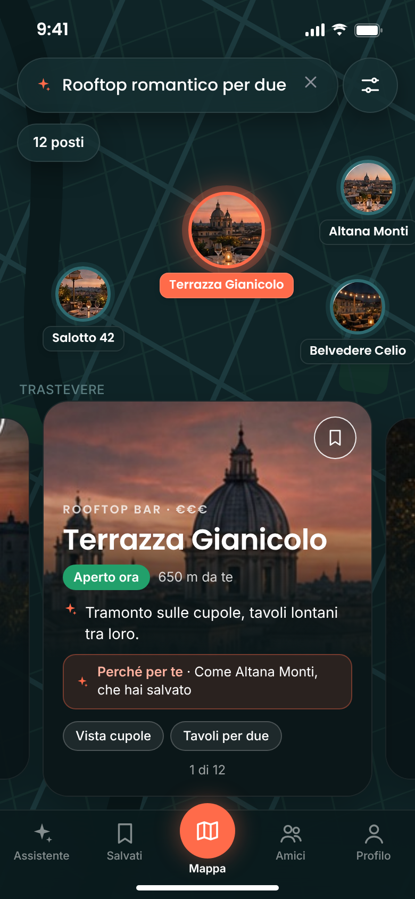 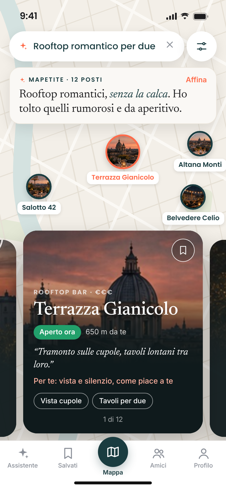

**Raccomandazione: A**, con la frase della C come contenuto della pillola "12 posti" quando la tocchi (oggi apre già "Ho capito / Affina").

---

## 3. Scheda del locale
Cosa principale: **il verdetto Mapetite**, sempre presente. Azioni fisse in basso: Prenota · Percorso · Salva (una sola volta ciascuna).

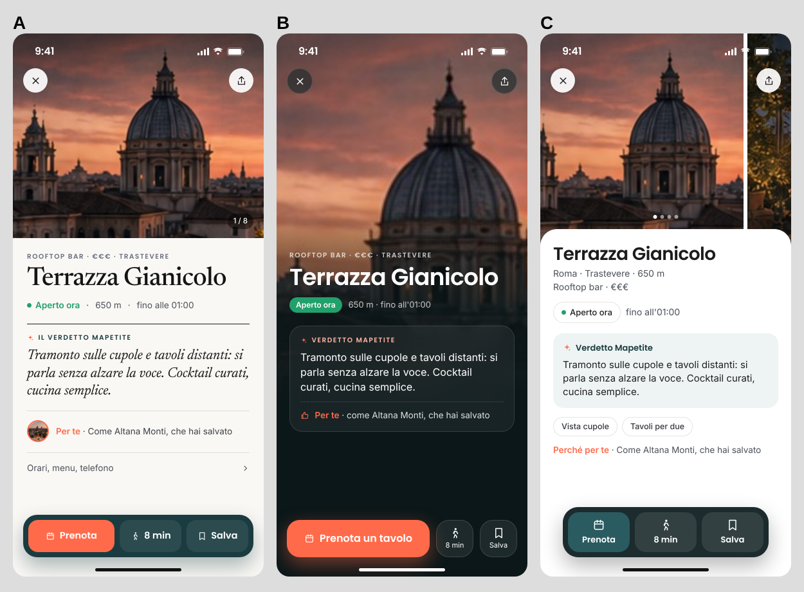

| | Direzione | Voto | Contro Places (`places-05`, `places-10`) |
|---|---|---|---|
| **A** | Foto in alto, nome grande in serif, riga "Aperto ora · 650 m · fino alle 01:00", poi **"Il verdetto Mapetite" in corsivo grande tra due filetti** come una citazione di rivista, "Per te · Come Altana Monti, che hai salvato", "Orari, menu, telefono ›". Barra teal con Prenota corallo. | **9** | Struttura di Places, ma il verdetto diventa l'elemento più importante della pagina: nessun concorrente ce l'ha. |
| **B** | Foto a tutto schermo con sfumatura scura, testo bianco, verdetto in vetro, grande "Prenota un tavolo" corallo. | 7,5 | Molto d'atmosfera, ma dipende dalla foto: le foto Google sono spesso piccole o storte, e a tutto schermo si vede. |
| **C** | Fedele a Places: carosello foto, foglio bianco, verdetto in riquadro teal chiaro, chip, barra azioni scura a 3 tasti. | 8 | Pulita e familiare; il verdetto c'è ma pesa come un riquadro qualsiasi. |

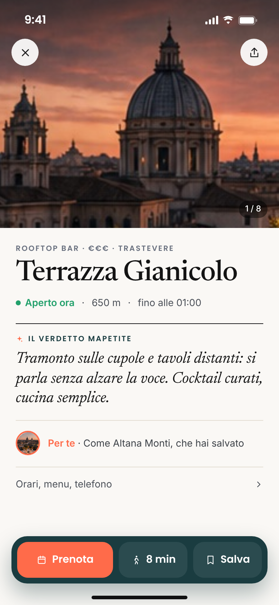 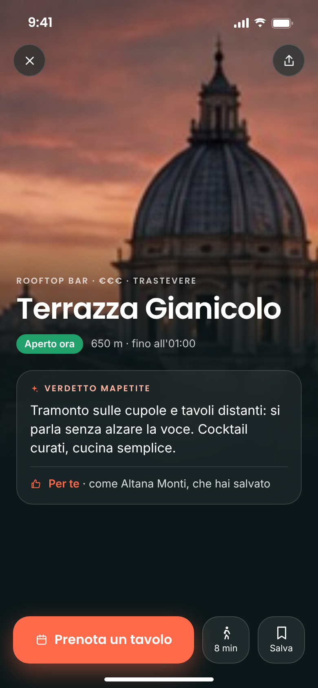 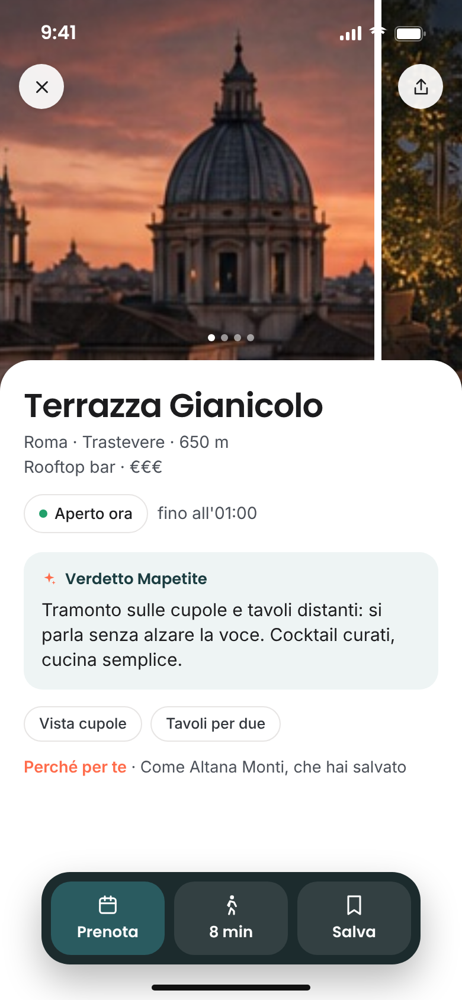

**Raccomandazione: A.** "Ci sono stato" e "Condividi" restano in "Altro" (regola del 17/10: niente doppioni).

---

## 4. Salvati (la tua mappa e le tue liste)
Cosa principale: **ritrovare un posto** salvato. Da provare / Ci sono stato, raccolte, da dove l'hai salvato.

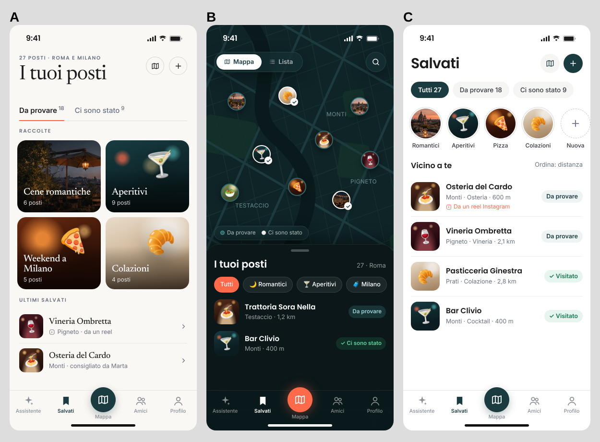

| | Direzione | Voto | Contro Places (`places-07`) e Albo (`albo-12`) |
|---|---|---|---|
| **A** | Titolo serif "I tuoi posti", due schede "Da provare 18 / Ci sono stato 9", raccolte come copertine di rivista 2×2, "Ultimi salvati" con "da un reel". | 8 | La più bella da mostrare; con tante raccolte le copertine occupano molto e la lista arriva tardi. |
| **B** | Mappa personale notturna (anello teal = da provare, bianco con ✓ = ci sono stato) e foglio dal basso con raccolte e lista. | 7,5 | Vicina a Mapstr ma più bella; doppia però la schermata Mappa. |
| **C** | Filtri "Tutti 27 / Da provare 18 / Ci sono stato 9", raccolte a cerchi (come le storie), lista per vicinanza con badge di stato e "Da un reel Instagram". | **8,5** | La più chiara da usare: in un colpo d'occhio stato, distanza e da dove arriva. Supera Places (che non ha stati così visibili). |

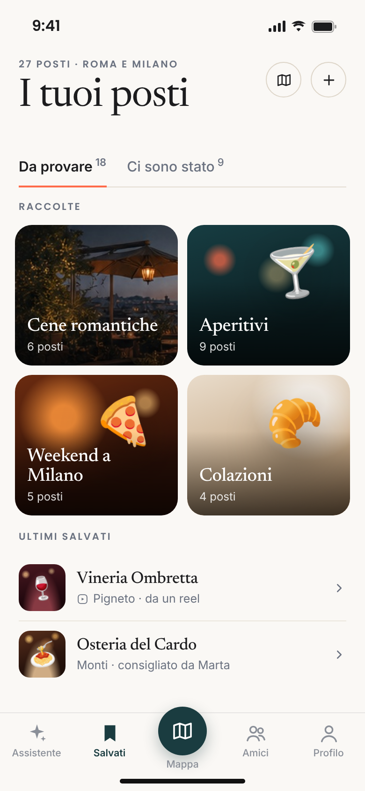 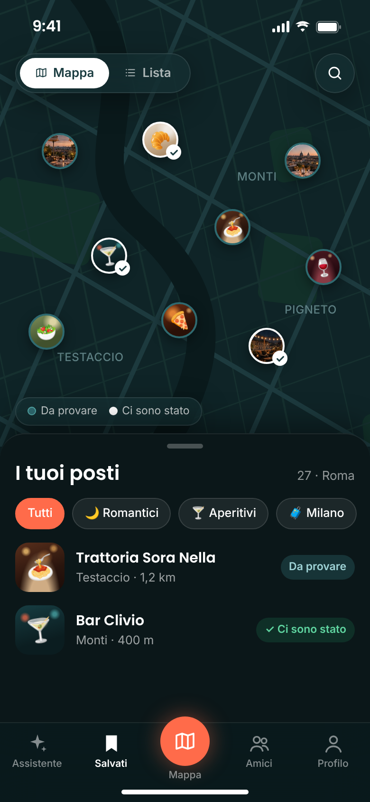 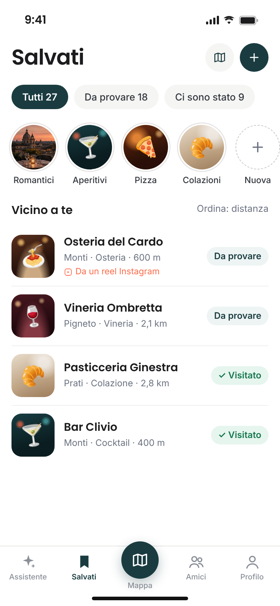

**Raccomandazione: C**, vestita con lo stile A (fondo carta e nomi in serif) se per le altre schermate scegli A, così l'app resta coerente.

---

## 5a. Primo accesso — valuta i locali ("mappa del gusto")
Cosa principale: **👍 o 👎** su 10 locali veri, misti tra famosi e chicche.

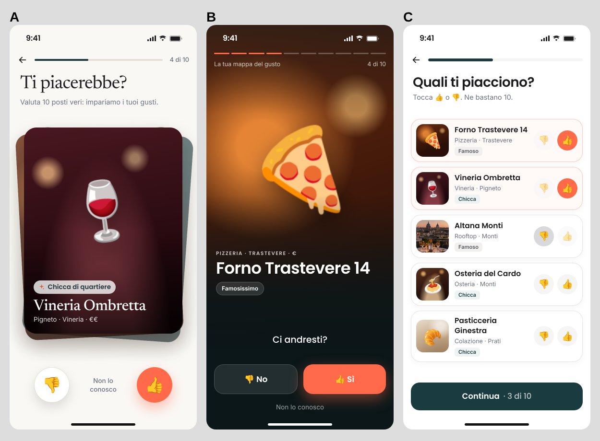

| | Direzione | Voto | Contro Albo (`albo-03`, `albo-04`) |
|---|---|---|---|
| **A** | Una card alla volta in pila, etichetta "Chicca di quartiere" o "Famoso", due grandi tasti 👎 / 👍 e "Non lo conosco" in mezzo. "4 di 10". | **8,5** | Una domanda per schermata come Albo, ma con locali veri: gesto familiare, veloce, perfetto da mostrare dal vivo. |
| **B** | Foto a tutto schermo, barra a 10 tacche in alto, "Ci andresti?", tasti No / Sì. | 7,5 | Immersiva, ma con foto Google mediocri peggiora; testo bianco su foto chiare a rischio. |
| **C** | Lista di 5 locali con 👎 👍 su ogni riga, "Continua · 3 di 10". | 8 | La più rapida (2 schermate per 10 locali), meno "magia". Buon piano B se A risulta lenta nei test. |

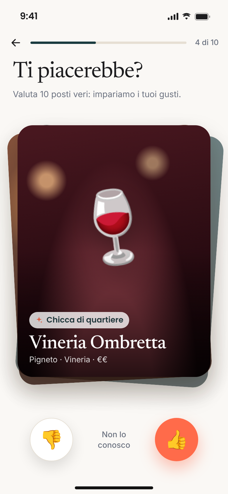 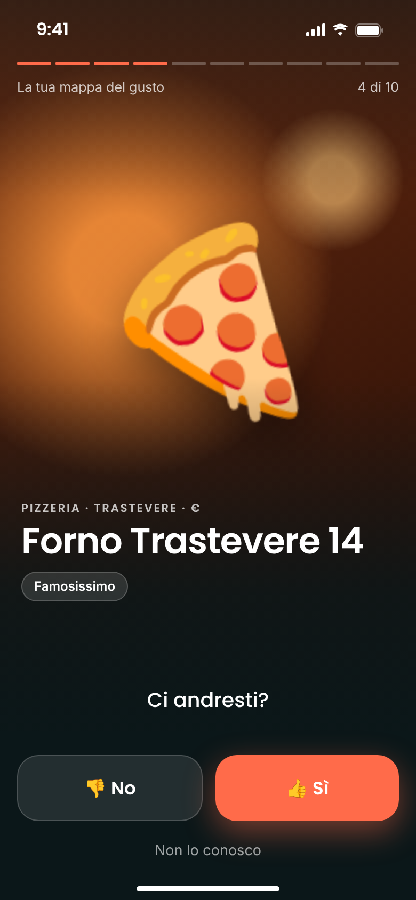 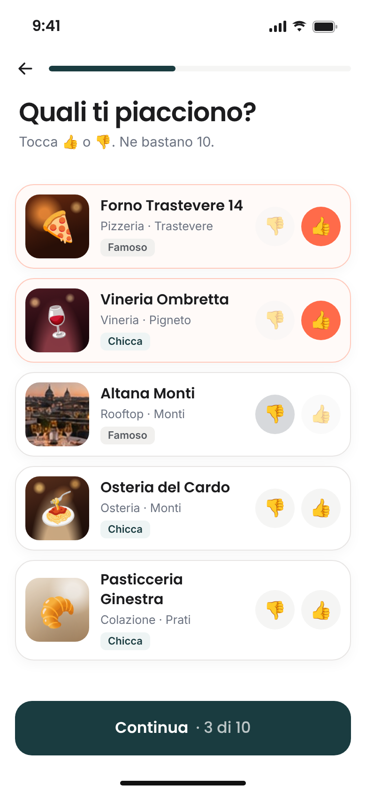

**Raccomandazione: A.**

## 5b. Primo accesso — "Ecco cosa ho capito di te"
Cosa principale: **riconoscersi** nella frase, poi aprire la mappa con 5 posti per te.

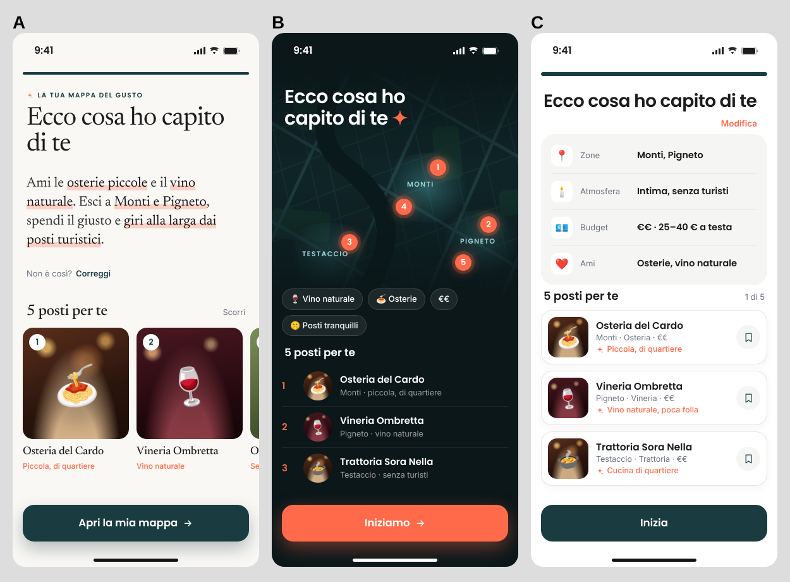

| | Direzione | Voto | Contro Albo (`albo-04`, `albo-05`) |
|---|---|---|---|
| **A** | Una frase scritta come da un amico, con le parole chiave evidenziate in corallo ("osterie piccole", "vino naturale", "Monti e Pigneto"…), "Non è così? Correggi", poi 5 posti per te in card foto. | **9** | È il momento "magia" di Albo, ma personale: si vede che l'AI ha capito, in parole umane. |
| **B** | Mappa notturna con le tue zone illuminate e i 5 posti numerati, chip dei gusti, lista numerata. | 8 | Effetto forte (la "mappa del gusto" si vede davvero); più dati, meno emozione. |
| **C** | Scheda profilo a righe (Zone, Atmosfera, Budget, Ami) con "Modifica", poi la lista. | 7,5 | Chiarissima e modificabile, ma sembra un modulo. |

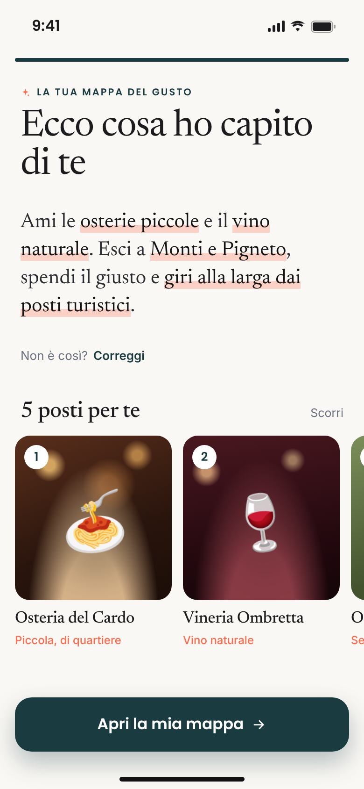 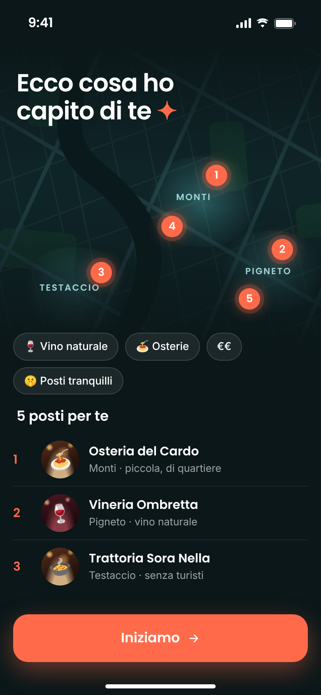 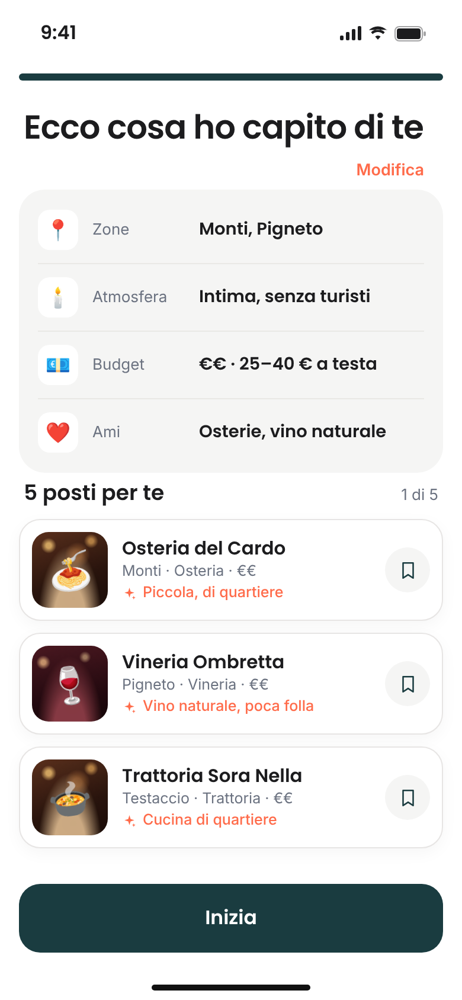

**Raccomandazione: A.** Vincolo: la frase va scritta solo con ciò che l'utente ha davvero indicato (zone, 👍/👎, occasioni, budget, diete): mai tratti inventati.

---

## In sintesi
| Schermata | Consiglio | Perché in una riga |
|---|---|---|
| Home | **A** | Cerca + "perché per te" visibile subito |
| Risultati | **A** | La B del 18/10 rifinita, con l'AI che si vede in ogni card |
| Scheda | **A** | Il verdetto diventa il centro della pagina |
| Salvati | **C** (in stile A) | La più chiara per ritrovare un posto |
| Primo accesso: valuta | **A** | Una card alla volta, veloce e da demo |
| Primo accesso: capito | **A** | Una frase che ti descrive davvero |

**Una sola decisione in più se scegli A:** i titoli passano a un serif (Newsreader, gratuito, già provato con `?titoli=serif`); Poppins resta per pulsanti, etichette e card scure dei risultati.

**Domanda per Lorenzo:** va bene "tutto come consigliato" (A, A, A, C, A, A)? Altrimenti scrivi la lettera per ogni schermata.

Sorgenti dei mockup: `docs/autonomia/mockup-21-10/` (per rigenerare un'immagine: `PW_MODULE=$(npm root -g)/playwright node docs/autonomia/mockup-21-10/render.mjs home-A`).
